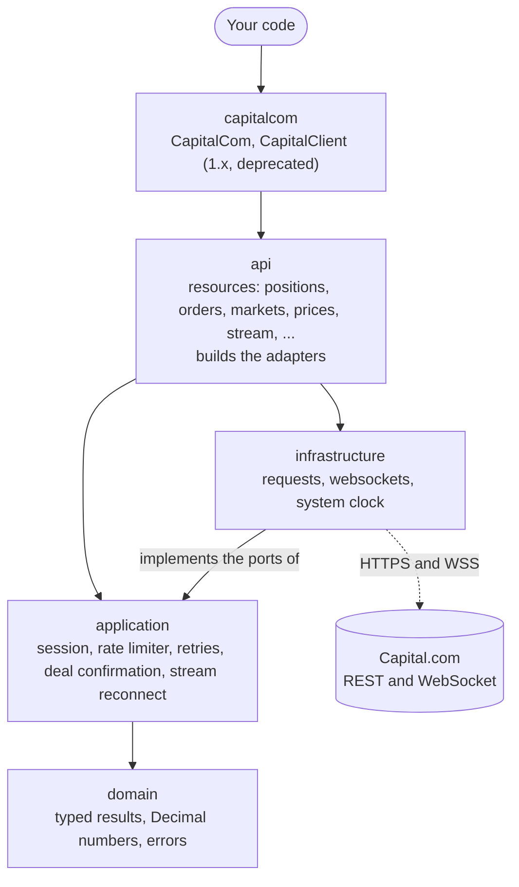
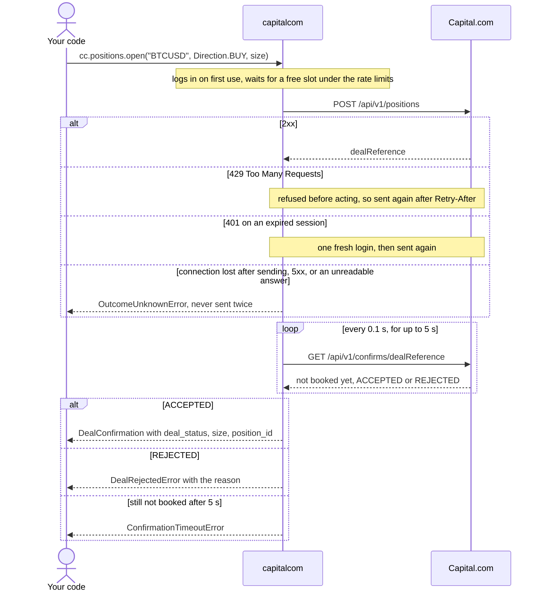
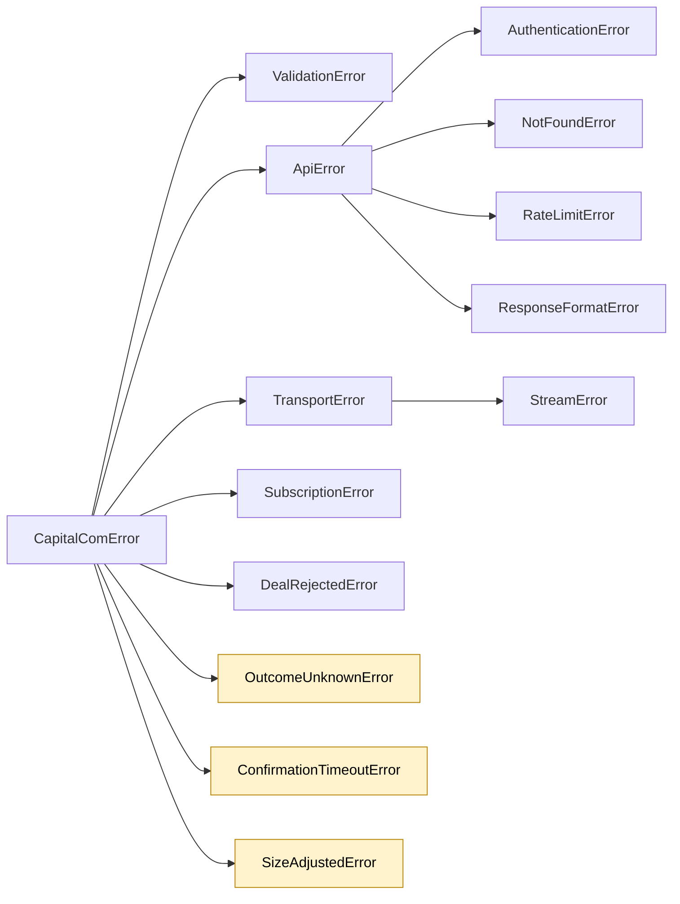

# CapitalCom [](https://github.com/Akinzou/CapitalCom/actions/workflows/ci.yml) [](https://github.com/Akinzou/CapitalCom/actions/workflows/ci.yml)    [](https://pepy.tech/projects/capitalcom)
[](https://discord.gg/BARYa55KS8)

A Python client for the [Capital.com](https://capital.com) REST and WebSocket API, for demo
and live accounts. It logs in and keeps the session alive, places trades and waits for their
confirmation, reads markets, prices and history, and streams live quotes. Results are typed
objects, numbers are `Decimal`, and failures are typed exceptions.

**Documentation: [akinzou.github.io/CapitalCom](https://akinzou.github.io/CapitalCom/)**

## Contents

- [Install](#install)
- [Quick start](#quick-start)
- [How it works](#how-it-works)
  - [Layers](#layers)
  - [A trade, step by step](#a-trade-step-by-step)
  - [Errors](#errors)
- [Going live](#going-live)
- [Coming from 1.x](#coming-from-1x)
- [License](#license)

## Install

```bash
pip install capitalcom
```

Optional extras: `capitalcom[streaming]` for live prices over the WebSocket, and
`capitalcom[encryption]` to send the password encrypted. Python 3.11 or newer; on an older Python, pip installs 1.0.4.

## Quick start

Create an API key in the Capital.com platform settings, export it with your login and the
key's password as `CAPITAL_API_KEY`, `CAPITAL_IDENTIFIER` and `CAPITAL_PASSWORD`, then run:

```python
"""Open the smallest BTCUSD position on the demo account, then close it."""

import os

from capitalcom import CapitalCom, Direction, Environment


def main() -> None:
    with CapitalCom(
        os.environ["CAPITAL_API_KEY"],
        os.environ["CAPITAL_IDENTIFIER"],
        os.environ["CAPITAL_PASSWORD"],
        environment=Environment.DEMO,
    ) as cc:
        market = cc.markets.get("BTCUSD")
        size = market.dealing_rules.min_deal_size.value  # a Decimal, e.g. 0.0001

        opened = cc.positions.open("BTCUSD", Direction.BUY, size)
        print(f"open: {opened.deal_status}, size {opened.size}")

        if opened.position_id is None:
            print("the deal netted against an existing position; nothing new to close")
            return
        closed = cc.positions.close(opened.position_id)
        print(f"close: {closed.deal_status}")


if __name__ == "__main__":
    main()
```

The output is the deal status and the booked size, then the close status. See
[Getting started](https://akinzou.github.io/CapitalCom/getting-started/) for the walk-through.

## How it works

The diagrams render on GitHub; elsewhere, such as on PyPI, they show as source.

### Layers

An arrow means "imports". The domain and application layers do no I/O of their own: they reach
the network and the clock only through ports, which the infrastructure adapters implement. The
`api` layer builds those adapters and hands them in, so the rest of the code never imports them.



### A trade, step by step

Capital.com answers a trade with a deal reference only; whether the deal was booked is known
once its confirmation says so. `cc.positions.open` waits for that answer, so the call returns
a booked deal or raises.



### Errors

Every error the library raises while talking to Capital.com is a `CapitalComError`. After a
highlighted one the trade may exist: check open positions and orders before you try again.



`SizeAdjustedError` is the one where the deal is certainly open, at a size other than the one
asked for. [Errors and reliability](https://akinzou.github.io/CapitalCom/guides/reliability/)
explains each case and what to do about it.

## Going live

The example trades on the demo account. `Environment.LIVE` sends the same calls to your real
account, with real money: read [Errors and reliability](https://akinzou.github.io/CapitalCom/guides/reliability/) first,
and try every change on demo.

## Coming from 1.x

`CapitalClient` keeps working in 2.x, with a `DeprecationWarning`, and will be removed no earlier than 3.0.
To stay on 1.x for now, pin `capitalcom<2` in your requirements.
The [migration guide](https://akinzou.github.io/CapitalCom/guides/migration/) maps each 1.x call to its 2.x equivalent.

## License

This project is licensed under the [PolyForm Noncommercial License 1.0.0](https://github.com/Akinzou/CapitalCom/blob/master/LICENSE).

In addition, any individual may use it to trade their own personal Capital.com accounts,
demo or live, including for profit. See [LICENSE-ADDITIONAL-PERMISSION](https://github.com/Akinzou/CapitalCom/blob/master/LICENSE-ADDITIONAL-PERMISSION)
for the exact terms. Commercial licences are available on request: root@yelon.dev or
wiktorjn@gmail.com.
